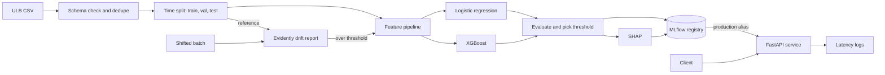
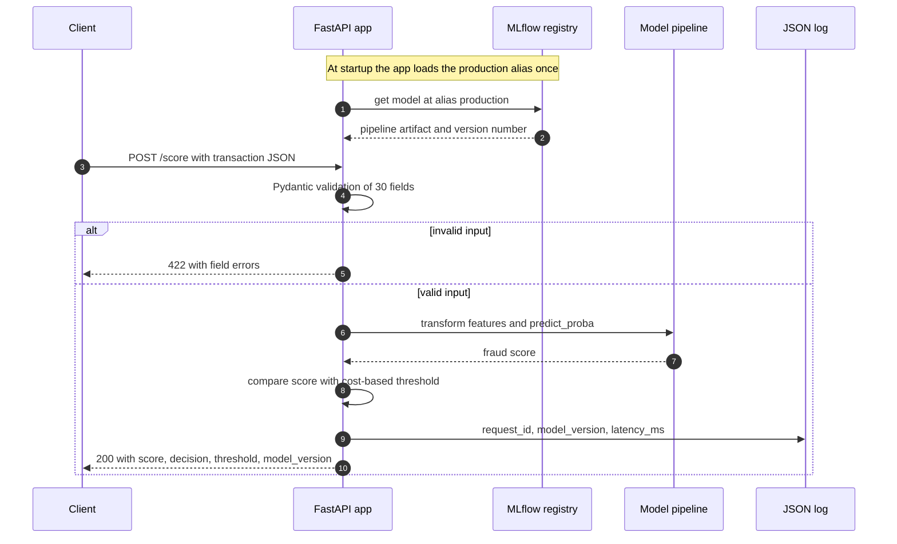
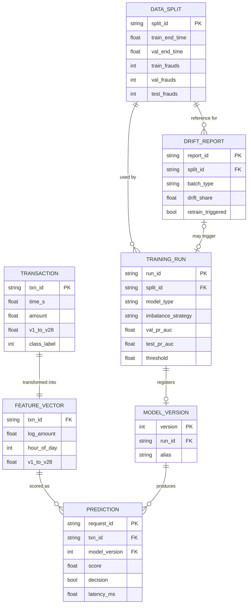
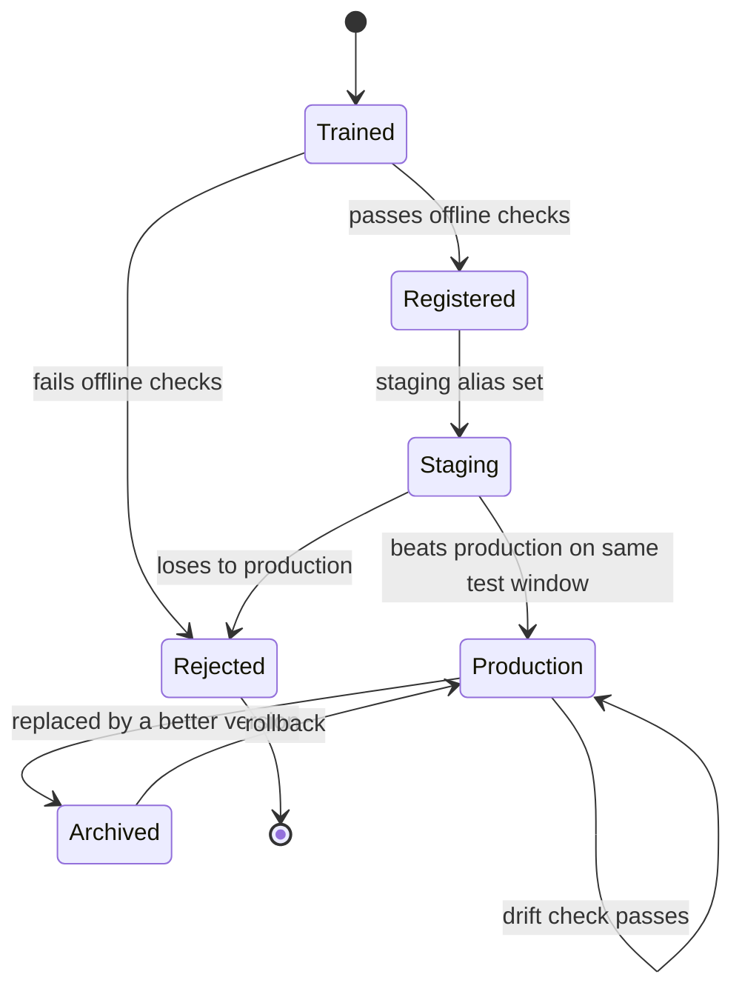
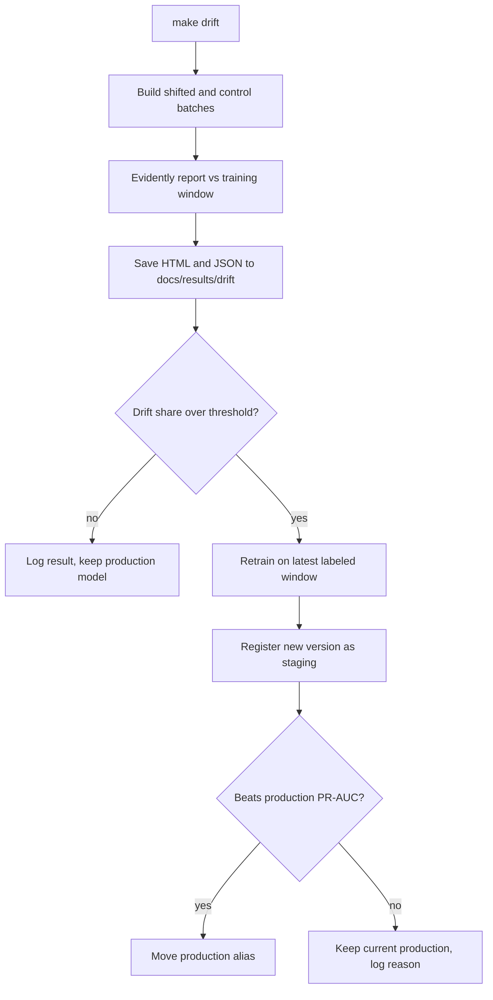
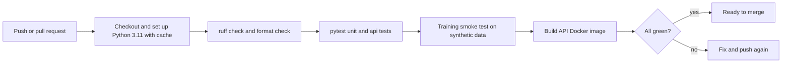
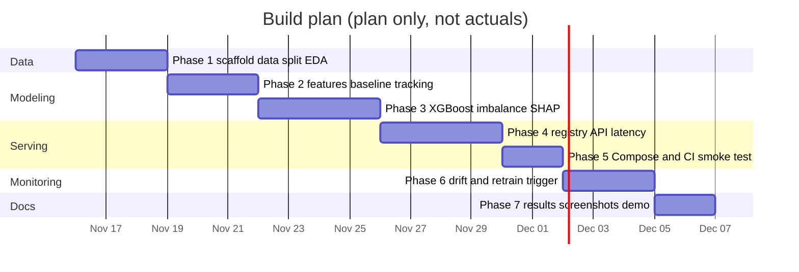

# FraudSight MLOps: overview, system design and workflow

Companion to [README.md](README.md). Pitches, interview questions and resume bullets are in [INTERVIEW.md](INTERVIEW.md). Everything here describes the design and the plan; where a number belongs it stays a placeholder until a real run fills it in `docs/results/`.

---

## Overview

"The problem is card fraud, and the hard part is that fraud is extremely rare. In the dataset I used, 492 of about 285,000 transactions are fraud. So accuracy is useless, and a lot of the work is about evaluating honestly.

I picked the ULB dataset over IEEE-CIS because it is one table, small enough to run on a laptop and in CI, and it has a time column. The features are already PCA components, so I was upfront that feature engineering is limited to amount and time features.

First I de-duplicate and split by time: train on the earliest 60%, validate on the next 20%, test on the last 20%. That mimics production, where you always predict the future. Then a scikit-learn pipeline builds features, and I train a logistic-regression baseline and XGBoost. For imbalance I compare three options on the same split: nothing, `scale_pos_weight`, and SMOTE applied only to the training fold.

For metrics I use PR-AUC as the headline, recall at 1% false-positive rate with precision next to it, and an expected-cost threshold where a missed fraud costs more than a false alarm. I report bootstrap confidence intervals because the test window has few frauds. SHAP TreeExplainer gives global importance and per-transaction reasons.

Everything is logged to MLflow. A promotion script moves a model to the staging alias, and to production only if it beats the current production model on the same test window. A FastAPI service loads the production alias, validates input with Pydantic and logs latency per request; I benchmark p95 latency with a script.

For monitoring I simulate a shifted batch, run an Evidently drift report against the training window, and if the share of drifted features passes a threshold it retrains and sends the new model through the same gate. Docker Compose runs MLflow and the API, and GitHub Actions runs lint, tests and a small training smoke test on synthetic data.

The results are in the README table: [measured metric] for PR-AUC, [measured metric] for p95 latency."

---

## Tech stack deep dive

| Tool | What it does here | Why this and not the alternative |
|---|---|---|
| Python 3.11 | Everything: pipeline, API, scripts | Supported by every library here. One pinned version so local, Docker and CI behave the same, instead of "whatever is installed" |
| pandas | Load, dedupe, sort and split the CSV | One 150 MB table fits in memory. Not Spark or Polars: no scale need, and pandas is what interviewers expect to read |
| scikit-learn | Feature `Pipeline`, logistic regression, metrics | Standard API and serializable pipelines. Not hand-written transforms, which drift between training and serving |
| imbalanced-learn | SMOTE inside a pipeline | Its `Pipeline` applies samplers only during `fit`. Not SMOTE on the full dataset, which leaks synthetic copies into validation |
| XGBoost | Main classifier | Strong on tabular data, native `scale_pos_weight`, built-in SHAP contributions. Not LightGBM: similar accuracy, one gradient-boosting library is enough to explain deeply. Not a neural net: no gain on 30 tabular features |
| SHAP | Global and per-transaction explanations | Exact TreeSHAP for trees with an additive, consistent definition. Not permutation importance, which is global only and unstable with correlated features |
| MLflow | Tracking, artifacts, registry with aliases | Open source, self-hosted, one tool for runs and registry. Not Weights & Biases: hosted and paid at team scale, and the registry is the main need |
| FastAPI | Scoring API | Pydantic validation and OpenAPI docs for free. Not Flask: no built-in validation. Not BentoML or Seldon: more to learn than the project needs |
| Evidently | Drift reports | Ready drift tests and HTML reports for tabular data. Not hand-rolled KS tests: more code to maintain. Not a hosted monitor: needs to run offline |
| Docker Compose | Runs MLflow and the API together | One command, reproducible. Not Kubernetes for the core: two containers on one machine do not need an orchestrator (K8s is a stretch goal) |
| pytest | Unit, API and smoke tests | Fixtures and parametrize make data tests short. Not unittest: more boilerplate |
| GitHub Actions | CI on every push | Free for public repos, lives next to the code. Not Jenkins: needs a server |
| ruff | Lint and format | One fast tool replaces flake8, isort and black |

### Concepts you must know

**Python and project setup**
- Virtual environments and lock files (`uv` or `pip-tools`) for reproducible installs
- Type hints with Pydantic models at boundaries
- Config from environment variables (`.env`) vs YAML for experiment settings

**pandas**
- Sorting by `Time` before any split; `iloc` slicing for contiguous windows
- `drop_duplicates` and why duplicates across a split boundary leak labels
- Rolling windows on time (`rolling("10min", closed="left")`) so a feature never includes the current or future rows
- `value_counts(normalize=True)` to report class balance per window

**scikit-learn**
- `Pipeline` and `ColumnTransformer`: fit on train only, transform val and test
- `FunctionTransformer` for `log1p` and hour-of-day
- `average_precision_score` vs `auc(recall, precision)`: average precision is a step sum and avoids the optimistic linear interpolation of the trapezoid rule
- `precision_recall_curve` and `roc_curve` to read off recall at a given FPR or precision
- `class_weight="balanced"` for logistic regression
- Calibration (`CalibratedClassifierCV`, isotonic vs sigmoid) and why reweighting distorts probabilities

**imbalanced-learn**
- SMOTE interpolates between a minority point and one of its k nearest minority neighbors
- `imblearn.pipeline.Pipeline` skips samplers at predict time
- SMOTE risks: noise amplification, overlap with the majority class, cost on large data

**XGBoost**
- Gradient boosting: each tree fits the gradient of the loss of the current ensemble
- `scale_pos_weight` multiplies the gradient and hessian of positive examples; a common start is negatives divided by positives
- Key parameters: `max_depth`, `learning_rate`, `n_estimators`, `subsample`, `colsample_bytree`, `min_child_weight`, `tree_method="hist"`
- Early stopping on a validation set with `eval_metric="aucpr"`
- `predict(..., pred_contribs=True)` returns SHAP values natively

**SHAP**
- Shapley values: average marginal contribution of a feature over all feature orderings
- TreeSHAP computes them exactly for trees in polynomial time
- Additivity: base value plus contributions equals the model output (log-odds for XGBoost)
- Global view (mean absolute SHAP) vs local view (one transaction)
- With PCA features (`V14`), SHAP says which component mattered, not a business reason

**MLflow**
- Experiment, run, parameters, metrics, artifacts
- Logging a model flavor (`mlflow.sklearn.log_model`) with a signature and input example
- Registered model, versions, and aliases (`@staging`, `@production`); stages are deprecated
- Model URI `models:/fraudsight-fraud@production`
- Tracking server with a backend store (SQLite here) and artifact store; `--serve-artifacts` proxies artifact downloads over HTTP

**FastAPI**
- Pydantic v2 models with `extra="forbid"`, field constraints and custom validators
- Lifespan handler to load the model once at startup
- Sync vs async endpoints: model prediction is CPU-bound, so a sync `def` runs in the thread pool and does not block the event loop
- Middleware for timing and request IDs
- Uvicorn workers and why each worker holds its own model copy

**Evidently**
- Reference data (training window) vs current data (new batch)
- Per-column drift tests chosen by type and sample size (for example KS for small numeric samples, Wasserstein distance for large ones; check the docs of the pinned version)
- Dataset drift as the share of drifted columns crossing a threshold
- Prediction drift vs data drift vs concept drift (needs labels)

**Docker Compose**
- Services, named volumes, networks, `depends_on` with `condition: service_healthy`
- Health checks and why the API should wait for MLflow
- Environment variables from `.env`
- Image size: slim base, multi-stage build, no training libraries in the serving image if possible

**pytest**
- Fixtures for a tiny synthetic dataset with the real schema
- Parametrized tests for metric functions against hand-computed values
- `TestClient` for API contract tests (valid input, missing field, extra field, NaN)
- A leakage test: assert max train `Time` is below min validation `Time`
- Marking the smoke test so it can be run separately

**GitHub Actions**
- Triggers (`push`, `pull_request`, `workflow_dispatch`), jobs, steps
- `actions/setup-python` with dependency caching
- Secrets are not needed for CI because no real data is downloaded
- Fail fast: lint before tests before the slower smoke test and image build

---

## System design and workflows

### 1. System flowchart

End-to-end view: offline training, registry, serving and the drift loop.

### 2. Scoring request sequence

What happens for one `POST /score`, including the validation failure path.

### 3. Data model

The main records and how they link: transactions, features, runs, model versions, predictions and drift reports.

### 4. Model version lifecycle

How a model version moves through the registry. Only one version holds `production` at a time, and rollback means moving the alias back.

### 5. Drift and retrain loop

The monitoring job. The gate at the end is the same one used for normal promotion.

### 6. CI workflow

What GitHub Actions runs on every push and pull request. Cheap checks run first.

### 7. Build plan

Planned phases only. These are target dates, not a record of work done.

---

## Trade-offs and what I'd change at 10x scale

**Trade-offs made in the core build**
- **ULB over IEEE-CIS**: easier to run and test, but anonymized PCA features limit feature engineering and explanations.
- **Batch training, online scoring, offline drift**: no streaming, so drift is checked per batch, not continuously.
- **Stateless serving features**: avoids skew but leaves predictive signal (velocity) out of the served model.
- **SQLite-backed MLflow**: fine for one user; not safe for concurrent writers.
- **Simulated drift**: proves the mechanism works, not that the threshold is right for real drift.
- **Simple promotion gate**: one metric on one window; a production gate would check several metrics and slices.

**At 10x scale**
- **Data and features**: transactions arrive on a stream (Kafka or similar); a feature store (Feast with Redis online, Parquet or a warehouse offline) serves velocity features with the same definitions in training and serving.
- **Training**: scheduled and event-triggered retraining in an orchestrator (Airflow, Prefect or Dagster) with data validation (pandera or Great Expectations) before training starts.
- **Registry**: MLflow on Postgres with artifacts in S3, plus access control.
- **Serving**: Kubernetes with autoscaling, a compiled model format, shadow deployments and canary rollouts between versions, and a model cache that does not depend on MLflow at startup.
- **Monitoring**: Prometheus metrics and Grafana dashboards for latency, error rate and score distribution; drift checks on a schedule with alerting; label feedback from analyst decisions and chargebacks to measure real precision and recall.
- **Evaluation**: per-segment metrics (merchant type, amount band, region) so a model that is better on average but worse on a key segment does not get promoted.

---

## Glossary

- **Average precision (AP)**: the step-wise area under the precision-recall curve; what this project reports as PR-AUC.
- **PR-AUC**: area under the precision-recall curve; sensitive to performance on the rare class.
- **ROC-AUC**: area under the true-positive rate vs false-positive rate curve; can look high on imbalanced data even with many false alarms.
- **Precision**: share of flagged transactions that are actually fraud.
- **Recall**: share of fraud that gets flagged.
- **False-positive rate (FPR)**: share of legitimate transactions that get flagged.
- **Recall at 1% FPR**: recall at the threshold where 1% of legitimate transactions are flagged.
- **Cost-based threshold**: the score cut-off that minimizes expected cost from missed frauds and false alarms.
- **Class imbalance**: one class is far rarer than the other; here about 0.17% fraud.
- **`scale_pos_weight`**: XGBoost parameter that up-weights positive examples in the loss.
- **SMOTE**: Synthetic Minority Over-sampling Technique; creates synthetic minority rows by interpolating between neighbors.
- **Calibration**: how well predicted scores match observed frequencies.
- **Time-based split**: train on earlier data, validate and test on later data.
- **Data leakage**: information from validation, test or the future reaching training.
- **Early stopping**: stop adding trees when the validation metric stops improving.
- **Gradient boosting**: an ensemble where each new tree corrects the errors of the previous ones.
- **SHAP value**: a feature's contribution to one prediction, based on Shapley values from game theory.
- **TreeSHAP**: an exact, fast SHAP algorithm for tree models.
- **Bootstrap confidence interval**: spread of a metric across resamples of the test set.
- **Experiment run**: one tracked training job in MLflow with its parameters, metrics and artifacts.
- **Model registry**: a store of versioned models with metadata.
- **Alias**: a named pointer (`staging`, `production`) to one model version in MLflow.
- **Promotion gate**: the rule a new version must pass before it becomes production.
- **Champion / challenger**: the current production model vs the candidate trying to replace it.
- **Training-serving skew**: features computed differently in training and in production.
- **Data drift**: input distributions change over time.
- **Prediction drift**: the model's score distribution changes.
- **Concept drift**: the relationship between inputs and the label changes; needs labels to confirm.
- **Label delay**: the time between a transaction and knowing whether it was fraud.
- **Drift share**: the share of features Evidently marks as drifted.
- **p95 latency**: the response time that 95% of requests are faster than.
- **Feature store**: a system that serves the same feature values for training (offline) and scoring (online).
- **PCA**: principal component analysis; the transform that produced the anonymized `V1`–`V28` features.
