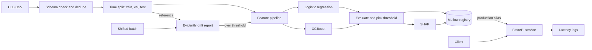
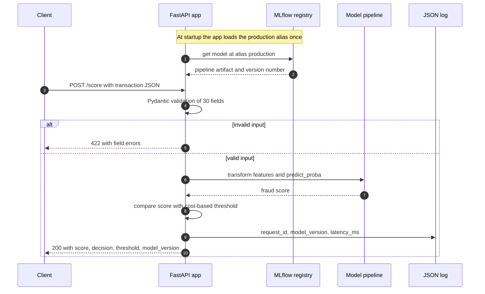
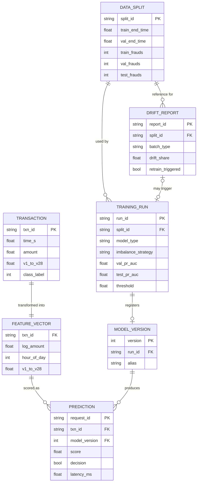
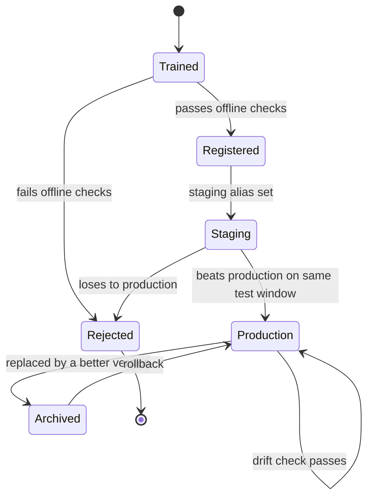
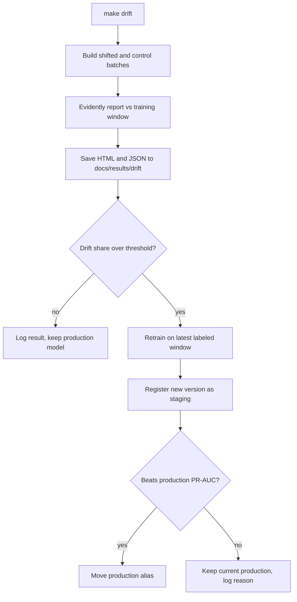
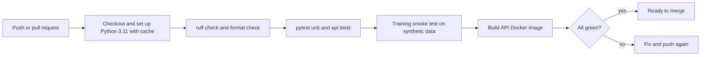
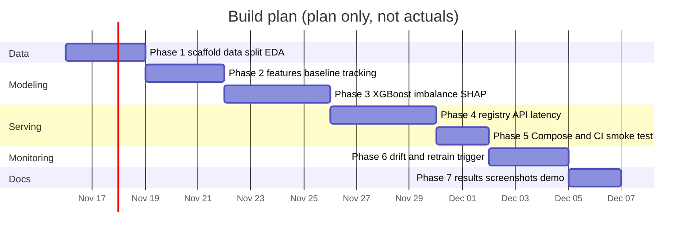

# FraudSight MLOps: interview prep

Companion to [README.md](README.md). Use this to explain the project end to end, defend each decision, and answer follow-ups. Nothing here is a measured result. Where a number belongs, it says `[measured metric]` or `—` until the run exists in `docs/results/`.

---

## At a glance

### 30-second pitch

I built an end-to-end fraud detection system on the public ULB card dataset, where only 0.17% of transactions are fraud. I split the data by time so the model never sees the future, compared class weights against SMOTE, and trained XGBoost against a logistic-regression baseline using PR-AUC and recall at a fixed false-positive rate instead of accuracy. The decision threshold comes from a cost formula, and SHAP explains each score. Every run is tracked in MLflow, models move from staging to production through a promotion gate, a FastAPI service serves the production model, and Evidently drift reports can trigger retraining. It all runs with Docker Compose and is tested in GitHub Actions.

### 2-minute walkthrough

"The problem is card fraud, and the hard part is that fraud is extremely rare. In the dataset I used, 492 of about 285,000 transactions are fraud. So accuracy is useless, and a lot of the work is about evaluating honestly.

I picked the ULB dataset over IEEE-CIS because it is one table, small enough to run on a laptop and in CI, and it has a time column. The features are already PCA components, so I was upfront that feature engineering is limited to amount and time features.

First I de-duplicate and split by time: train on the earliest 60%, validate on the next 20%, test on the last 20%. That mimics production, where you always predict the future. Then a scikit-learn pipeline builds features, and I train a logistic-regression baseline and XGBoost. For imbalance I compare three options on the same split: nothing, `scale_pos_weight`, and SMOTE applied only to the training fold.

For metrics I use PR-AUC as the headline, recall at 1% false-positive rate with precision next to it, and an expected-cost threshold where a missed fraud costs more than a false alarm. I report bootstrap confidence intervals because the test window has few frauds. SHAP TreeExplainer gives global importance and per-transaction reasons.

Everything is logged to MLflow. A promotion script moves a model to the staging alias, and to production only if it beats the current production model on the same test window. A FastAPI service loads the production alias, validates input with Pydantic and logs latency per request; I benchmark p95 latency with a script.

For monitoring I simulate a shifted batch, run an Evidently drift report against the training window, and if the share of drifted features passes a threshold it retrains and sends the new model through the same gate. Docker Compose runs MLflow and the API, and GitHub Actions runs lint, tests and a small training smoke test on synthetic data.

The results are in the README table: [measured metric] for PR-AUC, [measured metric] for p95 latency."

---

## Tech stack deep dive

| Tool | What it does here | Why this and not the alternative |
|---|---|---|
| Python 3.11 | Everything: pipeline, API, scripts | Supported by every library here. One pinned version so local, Docker and CI behave the same, instead of "whatever is installed" |
| pandas | Load, dedupe, sort and split the CSV | One 150 MB table fits in memory. Not Spark or Polars: no scale need, and pandas is what interviewers expect to read |
| scikit-learn | Feature `Pipeline`, logistic regression, metrics | Standard API and serializable pipelines. Not hand-written transforms, which drift between training and serving |
| imbalanced-learn | SMOTE inside a pipeline | Its `Pipeline` applies samplers only during `fit`. Not SMOTE on the full dataset, which leaks synthetic copies into validation |
| XGBoost | Main classifier | Strong on tabular data, native `scale_pos_weight`, built-in SHAP contributions. Not LightGBM: similar accuracy, one gradient-boosting library is enough to explain deeply. Not a neural net: no gain on 30 tabular features |
| SHAP | Global and per-transaction explanations | Exact TreeSHAP for trees with an additive, consistent definition. Not permutation importance, which is global only and unstable with correlated features |
| MLflow | Tracking, artifacts, registry with aliases | Open source, self-hosted, one tool for runs and registry. Not Weights & Biases: hosted and paid at team scale, and the registry is the main need |
| FastAPI | Scoring API | Pydantic validation and OpenAPI docs for free. Not Flask: no built-in validation. Not BentoML or Seldon: more to learn than the project needs |
| Evidently | Drift reports | Ready drift tests and HTML reports for tabular data. Not hand-rolled KS tests: more code to maintain. Not a hosted monitor: needs to run offline |
| Docker Compose | Runs MLflow and the API together | One command, reproducible. Not Kubernetes for the core: two containers on one machine do not need an orchestrator (K8s is a stretch goal) |
| pytest | Unit, API and smoke tests | Fixtures and parametrize make data tests short. Not unittest: more boilerplate |
| GitHub Actions | CI on every push | Free for public repos, lives next to the code. Not Jenkins: needs a server |
| ruff | Lint and format | One fast tool replaces flake8, isort and black |

### Concepts you must know

**Python and project setup**
- Virtual environments and lock files (`uv` or `pip-tools`) for reproducible installs
- Type hints with Pydantic models at boundaries
- Config from environment variables (`.env`) vs YAML for experiment settings

**pandas**
- Sorting by `Time` before any split; `iloc` slicing for contiguous windows
- `drop_duplicates` and why duplicates across a split boundary leak labels
- Rolling windows on time (`rolling("10min", closed="left")`) so a feature never includes the current or future rows
- `value_counts(normalize=True)` to report class balance per window

**scikit-learn**
- `Pipeline` and `ColumnTransformer`: fit on train only, transform val and test
- `FunctionTransformer` for `log1p` and hour-of-day
- `average_precision_score` vs `auc(recall, precision)`: average precision is a step sum and avoids the optimistic linear interpolation of the trapezoid rule
- `precision_recall_curve` and `roc_curve` to read off recall at a given FPR or precision
- `class_weight="balanced"` for logistic regression
- Calibration (`CalibratedClassifierCV`, isotonic vs sigmoid) and why reweighting distorts probabilities

**imbalanced-learn**
- SMOTE interpolates between a minority point and one of its k nearest minority neighbors
- `imblearn.pipeline.Pipeline` skips samplers at predict time
- SMOTE risks: noise amplification, overlap with the majority class, cost on large data

**XGBoost**
- Gradient boosting: each tree fits the gradient of the loss of the current ensemble
- `scale_pos_weight` multiplies the gradient and hessian of positive examples; a common start is negatives divided by positives
- Key parameters: `max_depth`, `learning_rate`, `n_estimators`, `subsample`, `colsample_bytree`, `min_child_weight`, `tree_method="hist"`
- Early stopping on a validation set with `eval_metric="aucpr"`
- `predict(..., pred_contribs=True)` returns SHAP values natively

**SHAP**
- Shapley values: average marginal contribution of a feature over all feature orderings
- TreeSHAP computes them exactly for trees in polynomial time
- Additivity: base value plus contributions equals the model output (log-odds for XGBoost)
- Global view (mean absolute SHAP) vs local view (one transaction)
- With PCA features (`V14`), SHAP says which component mattered, not a business reason

**MLflow**
- Experiment, run, parameters, metrics, artifacts
- Logging a model flavor (`mlflow.sklearn.log_model`) with a signature and input example
- Registered model, versions, and aliases (`@staging`, `@production`); stages are deprecated
- Model URI `models:/fraudsight-fraud@production`
- Tracking server with a backend store (SQLite here) and artifact store; `--serve-artifacts` proxies artifact downloads over HTTP

**FastAPI**
- Pydantic v2 models with `extra="forbid"`, field constraints and custom validators
- Lifespan handler to load the model once at startup
- Sync vs async endpoints: model prediction is CPU-bound, so a sync `def` runs in the thread pool and does not block the event loop
- Middleware for timing and request IDs
- Uvicorn workers and why each worker holds its own model copy

**Evidently**
- Reference data (training window) vs current data (new batch)
- Per-column drift tests chosen by type and sample size (for example KS for small numeric samples, Wasserstein distance for large ones; check the docs of the pinned version)
- Dataset drift as the share of drifted columns crossing a threshold
- Prediction drift vs data drift vs concept drift (needs labels)

**Docker Compose**
- Services, named volumes, networks, `depends_on` with `condition: service_healthy`
- Health checks and why the API should wait for MLflow
- Environment variables from `.env`
- Image size: slim base, multi-stage build, no training libraries in the serving image if possible

**pytest**
- Fixtures for a tiny synthetic dataset with the real schema
- Parametrized tests for metric functions against hand-computed values
- `TestClient` for API contract tests (valid input, missing field, extra field, NaN)
- A leakage test: assert max train `Time` is below min validation `Time`
- Marking the smoke test so it can be run separately

**GitHub Actions**
- Triggers (`push`, `pull_request`, `workflow_dispatch`), jobs, steps
- `actions/setup-python` with dependency caching
- Secrets are not needed for CI because no real data is downloaded
- Fail fast: lint before tests before the slower smoke test and image build

---

## Charts and workflows

### 1. System flowchart

End-to-end view: offline training, registry, serving and the drift loop.

### 2. Scoring request sequence

What happens for one `POST /score`, including the validation failure path.

### 3. Data model

The main records and how they link: transactions, features, runs, model versions, predictions and drift reports.

### 4. Model version lifecycle

How a model version moves through the registry. Only one version holds `production` at a time, and rollback means moving the alias back.

### 5. Drift and retrain loop

The monitoring job. The gate at the end is the same one used for normal promotion.

### 6. CI workflow

What GitHub Actions runs on every push and pull request. Cheap checks run first.

### 7. Build plan

Planned phases only. These are target dates, not a record of work done.

---

## Interview questions with answers

### Project overview

**1. Walk me through this project.**
It is a full lifecycle for card-fraud detection: data prep with a time-based split, a feature pipeline, a logistic-regression baseline and XGBoost, imbalance handling compared, evaluation with PR-AUC and a cost-based threshold, and SHAP explanations. Runs go to MLflow, and models are promoted from staging to production through a gate. A FastAPI service serves the production model, and Evidently drift reports on a shifted batch can trigger retraining. Docker Compose runs it locally and GitHub Actions tests it.

**2. Why the ULB dataset and not IEEE-CIS?**
ULB is one 150 MB table with a time column and 0.17% fraud, so it runs on a laptop, a sample fits in CI, and the imbalance is extreme enough to make the evaluation interesting. IEEE-CIS has two tables, 400+ columns and about 590K rows, and needs competition sign-up, which would pull the time budget toward feature wrangling. The cost is that ULB features are PCA components with no card ID, so I could not build per-card velocity features. I list IEEE-CIS as a stretch goal for that reason.

**3. What makes this MLOps and not just a model?**
The model is one step. The rest is making it reproducible (tracked runs, pinned dependencies, Docker), safe to change (a promotion gate and aliases so rollback is one command), observable (latency logs, drift reports), and tested (CI with a training smoke test). The question I wanted the system to answer is "can I replace this model next week without breaking anything", not only "is this model good".

**4. How do you know the model is good enough to ship?**
It has to beat the logistic-regression baseline on test PR-AUC with the confidence intervals not overlapping much, and it has to meet a recall target at an acceptable false-positive rate. The cost-based threshold has to produce a lower expected cost than the default 0.5 threshold. Then the promotion gate compares it to the current production model on the same window. The numbers are in the results table: [measured metric].

### Design decisions and trade-offs

**5. Why PR-AUC and not accuracy or ROC-AUC?**
Accuracy is 99.8% for a model that never flags fraud. ROC-AUC uses the false-positive rate, whose denominator is the huge negative class, so even many false alarms look like a tiny FPR and ROC-AUC stays high. PR-AUC uses precision, which directly shows how many alerts are real fraud, so it moves when the model gets better at the rare class. I compute it as average precision, which avoids the optimistic interpolation of the trapezoid rule.

**6. Why a time-based split?**
In production you always score transactions that happen after your training data. A random split lets the model learn from transactions after the ones it is tested on, and fraud comes in bursts, so near-duplicate fraud patterns land on both sides and inflate scores. A time split gives a more honest, usually lower, number. I also de-duplicate before splitting so identical rows cannot straddle the boundary.

**7. Class weights vs SMOTE: how did you compare them fairly?**
Same model, same hyperparameters, same time-ordered split; only the imbalance strategy changes, and I compare validation PR-AUC. SMOTE runs inside an imbalanced-learn pipeline, so it only resamples the training fold and never touches validation or test. Class weights are cheaper and do not invent data, so they are my default unless SMOTE wins clearly. The comparison is in the results table: [measured metric].

**8. How do you choose the decision threshold?**
I define expected cost as missed frauds times a cost per miss plus false alarms times a review cost, with the costs written down as assumptions in config. I sweep thresholds on the validation set, pick the one with the lowest cost, and apply it unchanged to test. Picking it on test would be tuning on the test set. The API returns the threshold with every score so downstream systems know the operating point.

**9. Why recall at 1% FPR, and why report precision next to it?**
Recall at a fixed FPR is how a fraud team thinks about alert budgets: "if we bother 1% of good customers, how much fraud do we catch". But at 0.17% fraud, 1% FPR can still mean several false alarms for each real fraud, so precision at that point shows whether the alert queue is workable. I also report recall at a fixed precision, which is the analyst-queue view.

**10. Why XGBoost, and why keep a logistic-regression baseline?**
Gradient-boosted trees are the standard strong model for tabular data, handle non-linear interactions without feature crosses, and have native class weighting and SHAP contributions. The baseline tells me whether the complexity pays off. On PCA features, which are already somewhat linear, a well-regularized logistic regression can be close, and if it is, that is a valid finding.

**11. Why does the served model use only stateless features?**
Features like "transactions in the last 10 minutes" need recent history at request time. Without an online store, the API would compute them differently from training, which is training-serving skew. So the served model uses features computable from one transaction, and the stateful ones are tested offline. Serving them properly is the Feast stretch goal.

**12. Are the scores probabilities?**
Not exactly. `scale_pos_weight` and SMOTE both shift the model toward the positive class, so raw scores overstate fraud probability. For ranking and a cost-based threshold, that is fine. If a downstream system needs real probabilities, I would calibrate on the validation window with isotonic regression and check a reliability curve.

**13. Why bootstrap confidence intervals?**
The test window only has a small number of frauds, so a few predictions flipping can move PR-AUC noticeably. Resampling the test set with replacement and recomputing the metric shows the spread. If the baseline and XGBoost intervals overlap heavily, I should not claim one is clearly better.

### Deep dives per tool

**14. What does `scale_pos_weight` do inside XGBoost?**
It multiplies the gradient and hessian of positive examples, so each fraud contributes more to the loss and to split decisions. A common starting value is negatives divided by positives in the training set. It changes the scale of predicted scores, which is why threshold choice and calibration matter afterwards. I also use early stopping with `aucpr` on validation to pick the number of trees.

**15. How does SHAP work and what are its limits here?**
SHAP assigns each feature its average marginal contribution across all orderings of features, and TreeSHAP computes this exactly for trees. The values add up: base value plus contributions equals the model's log-odds output. The limit on ULB is that `V1`–`V28` are PCA components, so SHAP can say `V14` pushed the score up, but not what that means in business terms. SHAP also explains the model, not causality.

**16. How does the MLflow registry work in your setup?**
Each training run logs parameters, metrics, artifacts and the full pipeline. A run's model is registered as a new version of `fraudsight-fraud`. Aliases point to versions: `staging` for the candidate, `production` for what the API serves. Promotion is moving the alias, and rollback is moving it back. I use aliases because the older stage API is deprecated.

**17. How does the API load the model and stay fast?**
A FastAPI lifespan handler loads `models:/fraudsight-fraud@production` once at startup and keeps it in memory, so no request touches MLflow. Prediction is CPU-bound, so the endpoint is a plain `def`, which FastAPI runs in a thread pool instead of blocking the event loop. Each Uvicorn worker has its own copy of the model. Latency per request is measured in middleware and logged.

**18. What does Pydantic validation catch?**
Missing fields, wrong types, extra fields (with `extra="forbid"`), NaN or infinite values and negative amounts. FastAPI returns a 422 with field-level errors before the model runs. This protects the model from silent garbage, for example a client sending amounts in cents or a renamed column.

**19. How does Evidently decide something drifted?**
For each column it runs a statistical test or distance between the reference data and the current batch; the method depends on column type and sample size (for example KS for small numeric samples, Wasserstein distance for larger ones). A column is drifted if the test crosses its threshold, and the dataset drifts if the share of drifted columns crosses a dataset-level threshold. I also check drift in the model's score distribution, which is available before labels arrive.

**20. How do the containers talk to each other in Docker Compose?**
They share a Compose network, so the API reaches MLflow at `http://mlflow:5000`. MLflow runs with `--serve-artifacts`, so the API downloads model files over HTTP and does not need a shared volume. The API service uses `depends_on` with `condition: service_healthy` so it starts only after MLflow answers its health check.

**21. What does the CI pipeline test, given the dataset is not in the repo?**
Lint and format with ruff, unit tests for the split, features, metrics and threshold logic, API contract tests with FastAPI's `TestClient`, and a training smoke test. The smoke test generates a small synthetic dataset with the real schema and about 1% positives, runs the full train and log path against a local file-based MLflow store, and checks that a model artifact and metrics come out. Then it builds the API image.

**22. What do you test in ML code beyond "it runs"?**
That the split has no time overlap (max train time below min validation time). That metric functions match hand-computed values on tiny examples. That the threshold function returns the cost-minimizing value on a known case. That the API rejects bad input and returns the documented schema. That the pipeline gives the same output for the same input after save and load.

**23. How do you build rolling features in pandas without leakage?**
Sort by time, then use a time-based rolling window with `closed="left"` so the window excludes the current row, or shift by one before rolling. The window must only use rows strictly earlier than the transaction being scored. I would add a test that changing a future row does not change a past row's features.

### Scaling and failure modes

**24. How would this handle 10,000 transactions per second?**
Run several API replicas behind a load balancer with autoscaling on CPU or latency, keep the model in memory, and consider converting XGBoost to a compiled format (for example Treelite or ONNX) to cut per-request time. Use batch endpoints where the caller can buffer. Move logs to an async pipeline so logging never blocks scoring. MLflow is not in the request path, so it does not need to scale with traffic.

**25. What if MLflow is down when the API starts?**
The API cannot load a model, so it should fail its readiness check and not accept traffic, rather than serve without a model. In production I would also cache the last loaded model artifact locally or bake it into the image, so a restart does not depend on MLflow being up. Already running replicas are unaffected because they hold the model in memory.

**26. A bad model got promoted. How do you roll back?**
Move the `production` alias back to the previous version and restart or signal the API to reload. Because versions are immutable and every run is tracked, the previous model is exactly what was served before. Then I would find why the gate let it through, for example the comparison window was not representative.

**27. Drift is detected but fraud labels arrive weeks later. What do you do?**
Data drift and score drift are available right away, so they are early warnings, not proof the model is worse. I would alert, look at which features moved, and watch alert volume and precision from analyst feedback, which arrives faster than chargebacks. Retraining needs labeled data, so it uses the latest labeled window, and the trigger should not retrain blindly on unlabeled drift.

**28. How can retraining create a feedback loop?**
If the model blocks transactions, those never become confirmed fraud or legitimate, so future training data is biased toward what the old model let through. Mitigations are keeping a small random holdout that is not blocked (where policy allows), using analyst review outcomes as labels, and logging the model version that made each decision.

**29. How do you prevent training-serving skew?**
The feature transform is part of the logged pipeline, so the API runs exactly the fitted transform. The request schema mirrors the training columns. Stateful features are kept out of serving until a feature store can compute them the same way in both places. A test compares pipeline output before and after save and load.

### Debugging scenarios

**30. p95 latency doubled after a release. What do you check?**
First, whether the model changed: more or deeper trees, or SHAP turned on by default. Then the logs by endpoint and model version to see if it is all requests or a subset, for example large batches. Then CPU usage per worker and the worker count, and whether a sync library call slipped into an async endpoint and is blocking the event loop. Finally, cold-start effects if replicas restarted.

**31. PR-AUC is great offline but production precision is poor. Why?**
Most likely leakage or a split mismatch offline: a random split, duplicates across the boundary, or the threshold tuned on test. Next, skew between how features are built offline and online. Then real drift: the fraud pattern or customer mix changed. I would rescore recent production data offline with the same pipeline and compare to what the API returned.

**32. Many requests suddenly get 422 responses. What happened?**
The client changed its payload: a renamed field, a new field (rejected by `extra="forbid"`), strings instead of floats, or NaN. The 422 body names the failing fields, so I would group errors by field and client version. The fix is a versioned API contract, not loosening validation silently.

**33. The CI smoke test is flaky. Where do you look?**
Randomness: the synthetic data or model training without a fixed seed, or SMOTE's nearest neighbors with ties. Then assertions that are too tight on metric values from a tiny dataset; the smoke test should check that things run and produce artifacts, not exact scores. Then shared state, such as a fixed MLflow directory reused across tests instead of a `tmp_path`.

**34. The drift report flags every feature. Is it real?**
Probably a pipeline problem first: the reference and current data are in different units or one is already transformed, or the columns are misaligned. With large samples, statistical tests also flag tiny, harmless shifts, so I would check effect sizes, not just p-values. If it is real, every feature moving at once usually means an upstream change, not fraud behavior.

**35. The model predicts almost no fraud on new data. What do you check?**
That the served threshold matches the one chosen on validation, and that the right version is loaded (`/model-info`). Then input scaling: amounts in the wrong unit or a feature passed in a different order. Then the score distribution vs the test window: if scores collapsed, compare input distributions with the drift report.

### Behavioral (STAR outlines)

**36. Tell me about a trade-off you made under a time limit.**
- Situation: a 2–4 week build with a lot of possible scope (feature store, Kafka, Kubernetes).
- Task: ship a complete, testable lifecycle that I could explain line by line.
- Action: cut the core to batch training, a registry, one API and drift checks; moved Feast, Kubernetes and the LLM explainer to stretch goals; chose ULB over IEEE-CIS to keep data work small.
- Result: [measured outcome, for example phases completed and time taken]; what I would do next is [stretch goal chosen].

**37. Tell me about a time you found a problem in your own evaluation.**
- Situation: early results on [split or setup] looked [describe].
- Task: confirm whether the number was real before reporting it.
- Action: [for example compared random vs time split, checked duplicates across the boundary, added a leakage test].
- Result: PR-AUC moved from [measured metric] to [measured metric]; the test now runs in CI.

**38. Tell me about explaining a model to a non-technical audience.**
- Situation: [who needed to understand the fraud scores, for example a reviewer or demo audience].
- Task: explain why a transaction was flagged without jargon.
- Action: used SHAP to show the top factors for one transaction and the cost trade-off behind the threshold.
- Result: [their feedback or decision]; what I learned about [what to change].

---

## Trade-offs and what I'd change at 10x scale

**Trade-offs made in the core build**
- **ULB over IEEE-CIS**: easier to run and test, but anonymized PCA features limit feature engineering and explanations.
- **Batch training, online scoring, offline drift**: no streaming, so drift is checked per batch, not continuously.
- **Stateless serving features**: avoids skew but leaves predictive signal (velocity) out of the served model.
- **SQLite-backed MLflow**: fine for one user; not safe for concurrent writers.
- **Simulated drift**: proves the mechanism works, not that the threshold is right for real drift.
- **Simple promotion gate**: one metric on one window; a production gate would check several metrics and slices.

**At 10x scale**
- **Data and features**: transactions arrive on a stream (Kafka or similar); a feature store (Feast with Redis online, Parquet or a warehouse offline) serves velocity features with the same definitions in training and serving.
- **Training**: scheduled and event-triggered retraining in an orchestrator (Airflow, Prefect or Dagster) with data validation (pandera or Great Expectations) before training starts.
- **Registry**: MLflow on Postgres with artifacts in S3, plus access control.
- **Serving**: Kubernetes with autoscaling, a compiled model format, shadow deployments and canary rollouts between versions, and a model cache that does not depend on MLflow at startup.
- **Monitoring**: Prometheus metrics and Grafana dashboards for latency, error rate and score distribution; drift checks on a schedule with alerting; label feedback from analyst decisions and chargebacks to measure real precision and recall.
- **Evaluation**: per-segment metrics (merchant type, amount band, region) so a model that is better on average but worse on a key segment does not get promoted.

---

## Resume bullets

Templates only. Fill the brackets from `docs/results/` after the runs exist.

- Built an end-to-end card-fraud MLOps pipeline (XGBoost, MLflow, FastAPI, Evidently, Docker Compose) on a dataset with 0.17% fraud, using a time-based split and cost-based thresholding; improved PR-AUC from [measured metric] (logistic regression baseline) to [measured metric].
- Compared class weighting and SMOTE for extreme imbalance and selected [strategy] at [measured metric] recall at 1% false-positive rate; added SHAP explanations for global and per-transaction review.
- Deployed the production model behind a validated FastAPI service with an MLflow staging-to-production promotion gate and Evidently drift-triggered retraining, at [measured metric] p95 latency; CI on GitHub Actions runs lint, tests and a training smoke test on every push.

---

## Glossary

- **Average precision (AP)**: the step-wise area under the precision-recall curve; what this project reports as PR-AUC.
- **PR-AUC**: area under the precision-recall curve; sensitive to performance on the rare class.
- **ROC-AUC**: area under the true-positive rate vs false-positive rate curve; can look high on imbalanced data even with many false alarms.
- **Precision**: share of flagged transactions that are actually fraud.
- **Recall**: share of fraud that gets flagged.
- **False-positive rate (FPR)**: share of legitimate transactions that get flagged.
- **Recall at 1% FPR**: recall at the threshold where 1% of legitimate transactions are flagged.
- **Cost-based threshold**: the score cut-off that minimizes expected cost from missed frauds and false alarms.
- **Class imbalance**: one class is far rarer than the other; here about 0.17% fraud.
- **`scale_pos_weight`**: XGBoost parameter that up-weights positive examples in the loss.
- **SMOTE**: Synthetic Minority Over-sampling Technique; creates synthetic minority rows by interpolating between neighbors.
- **Calibration**: how well predicted scores match observed frequencies.
- **Time-based split**: train on earlier data, validate and test on later data.
- **Data leakage**: information from validation, test or the future reaching training.
- **Early stopping**: stop adding trees when the validation metric stops improving.
- **Gradient boosting**: an ensemble where each new tree corrects the errors of the previous ones.
- **SHAP value**: a feature's contribution to one prediction, based on Shapley values from game theory.
- **TreeSHAP**: an exact, fast SHAP algorithm for tree models.
- **Bootstrap confidence interval**: spread of a metric across resamples of the test set.
- **Experiment run**: one tracked training job in MLflow with its parameters, metrics and artifacts.
- **Model registry**: a store of versioned models with metadata.
- **Alias**: a named pointer (`staging`, `production`) to one model version in MLflow.
- **Promotion gate**: the rule a new version must pass before it becomes production.
- **Champion / challenger**: the current production model vs the candidate trying to replace it.
- **Training-serving skew**: features computed differently in training and in production.
- **Data drift**: input distributions change over time.
- **Prediction drift**: the model's score distribution changes.
- **Concept drift**: the relationship between inputs and the label changes; needs labels to confirm.
- **Label delay**: the time between a transaction and knowing whether it was fraud.
- **Drift share**: the share of features Evidently marks as drifted.
- **p95 latency**: the response time that 95% of requests are faster than.
- **Feature store**: a system that serves the same feature values for training (offline) and scoring (online).
- **PCA**: principal component analysis; the transform that produced the anonymized `V1`–`V28` features.
