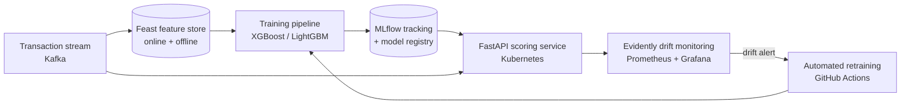

# Precog – Fraud MLOps

**An end-to-end MLOps platform for real-time credit card fraud detection**

XGBoost · LightGBM · Feast · MLflow · FastAPI · Kafka · Docker · Kubernetes · Evidently · GitHub Actions · AWS

> **Status: under active development.** This README is the design spec. The checklist in the [Roadmap](#roadmap) shows what is built so far.

---

## Overview

Precog covers the full machine learning lifecycle for a high-stakes, heavily imbalanced problem: catching fraudulent card transactions within milliseconds.

It is built on the public **ULB credit card fraud dataset** (about 284K transactions, roughly 0.17% fraud). Transactions are also replayed as a live stream so the system runs as it would in production, not just in a notebook.

## Lifecycle



## Machine learning

- **Imbalance handling:** class weights, focal loss and SMOTE, compared using **PR-AUC** (accuracy is misleading at 0.17% fraud)
- **Models:** logistic regression baseline, Random Forest, **XGBoost**, **LightGBM**, and an autoencoder anomaly detector
- **Features:** transaction velocity, rolling amount statistics and time-of-day patterns, defined once in **Feast** so training and serving use the same values
- **Tuning:** Optuna with time-aware cross-validation to prevent data leakage
- **Thresholds:** decision threshold chosen by business cost (cost of a missed fraud vs. cost of a false alarm)
- **Explainability:** SHAP explanations for individual predictions and for the model as a whole

## MLOps

- **Experiment tracking and registry:** MLflow, with models promoted from staging to production
- **Serving:** FastAPI scoring service on **Kubernetes**, with p95 latency targets and autoscaling
- **Safe releases:** shadow mode and **canary rollouts** between model versions
- **Monitoring:** **Evidently** data and prediction drift reports, with Prometheus metrics and Grafana dashboards
- **CI/CD:** GitHub Actions for tests, data validation, training, model gating and deployment
- **Reproducibility:** Docker images, pinned dependencies and data versioning

## Planned repository structure

```
precog-fraud-mlops/
├── features/            # Feast feature definitions
├── training/            # training pipelines, tuning, evaluation
├── serving/             # FastAPI scoring service
├── streaming/           # Kafka transaction replayer
├── monitoring/          # Evidently reports, Grafana dashboards
├── k8s/                 # Kubernetes manifests / Helm chart
├── notebooks/           # EDA, model comparison, SHAP analysis
├── tests/
└── .github/workflows/   # CI/CD + retraining
```

## Roadmap

- [ ] EDA and baseline models
- [ ] Feast feature store with offline and online features
- [ ] XGBoost / LightGBM training with Optuna and MLflow
- [ ] Cost-based thresholds and SHAP explanations
- [ ] FastAPI scoring service with Docker
- [ ] Kafka transaction replayer for real-time scoring
- [ ] Kubernetes deployment with canary rollouts
- [ ] Evidently drift monitoring + Grafana
- [ ] Automated retraining pipeline in GitHub Actions
- [ ] Load test and latency benchmarks

## Dataset

Credit Card Fraud Detection (ULB Machine Learning Group): a public, anonymized dataset of European cardholder transactions.

## Author

**Hasan Mohd Hussain**: [GitHub](https://github.com/striderzz) · [LinkedIn](https://www.linkedin.com/in/hasan-m-4b1bba315/) · [Portfolio](https://striderzz.github.io/portfolio-website/)
