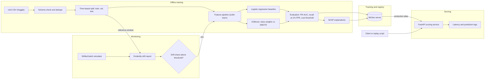

# FraudSight MLOps

Card-fraud detection taken from raw data to a versioned, monitored scoring API: XGBoost, MLflow registry, FastAPI and Evidently drift checks.

> Status: in development — design spec and build plan; results land as each phase ships.

         

---

## Why this exists

Fraud is rare. In the public ULB card dataset, 492 of 284,807 transactions are fraud (about 0.17%). A model that says "not fraud" every time is 99.8% accurate and useless. A useful fraud model has to be judged on metrics built for imbalance, split by time so it never sees the future, and tuned to a threshold that reflects what a missed fraud and a false alarm actually cost. Then it has to be served, versioned and watched, because fraud patterns move. Most portfolio fraud projects stop at a notebook. FraudSight covers the whole loop on one laptop: train, compare, register, serve, detect drift, retrain.

## What it does

- **Leakage-safe data prep**: schema checks, duplicate removal and a time-based train / validation / test split, so the test set is always "the future"
- **Feature pipeline**: one scikit-learn pipeline (log amount, hour of day, scaling) saved with the model, so training and serving run the same transform
- **Imbalance handling compared**: no rebalancing vs `scale_pos_weight` (class weights) vs SMOTE, each scored on the same time-ordered validation set
- **XGBoost vs a logistic-regression baseline**: the baseline sets the bar a more complex model has to beat
- **Metrics for rare events**: PR-AUC (average precision), recall at 1% false-positive rate, recall at fixed precision, and a decision threshold picked by expected cost
- **SHAP explanations**: global feature importance and per-transaction contributions, logged with each run and available from the API
- **MLflow tracking and registry**: every run logged; models move from `staging` to `production` through a promotion gate
- **FastAPI scoring service**: loads the `production` model, validates input with Pydantic, logs per-request latency
- **Drift detection with a retrain trigger**: Evidently compares a simulated shifted batch to the training window; above a threshold, retraining starts and the new model has to win before it is promoted

## Architecture



Raw transactions are checked against a schema, de-duplicated and split by time, so validation and test always come after the training window. A single scikit-learn feature pipeline feeds both the logistic-regression baseline and XGBoost, and every run (parameters, metrics, PR curves, SHAP plots, the fitted pipeline) is logged to MLflow. A promotion script moves a registered model to the `staging` alias, then to `production` only if it beats the current production model on the same holdout. The FastAPI service loads whatever model holds the `production` alias, validates each request and logs latency. A simulator produces a shifted batch, Evidently measures drift against the training window, and if the drifted-feature share crosses the configured threshold the training pipeline runs again and the new model goes through the same gate.

## How it works

### Dataset choice

The primary dataset is the **ULB credit card fraud dataset** (Kaggle `mlg-ulb/creditcardfraud`): 284,807 European card transactions over two days in September 2013, 492 of them fraud. Columns are `Time` (seconds since the first transaction), `Amount`, `Class`, and `V1`–`V28`, which are PCA components of the original (confidential) features.

Why ULB over IEEE-CIS:

- It is small (about 150 MB, one table), so the full pipeline runs on a laptop and a sampled copy fits in CI.
- `Time` gives a clean ordering for a time-based split.
- 0.17% fraud is the extreme imbalance this project is about.
- It downloads with a free Kaggle account. IEEE-CIS requires joining a competition and accepting its rules, has two tables, 400+ columns and about 590K training rows, which pushes the time budget toward feature wrangling instead of MLOps.

The honest limit: because `V1`–`V28` are already PCA-transformed and there is no card or customer ID, feature engineering on ULB is modest (amount and time features only), and per-card velocity features are not possible. IEEE-CIS is listed as a stretch goal for that reason.

### Data prep and time-based split

`Time` is sorted, exact duplicate rows are dropped before splitting (duplicates across a split boundary leak labels), and the data is cut into three contiguous windows: roughly the first 60% for training, the next 20% for validation (early stopping, threshold choice, model comparison) and the last 20% for the final test. A random stratified split would let the model train on transactions from after the ones it is tested on, which overstates performance on rare, bursty fraud. The split boundaries and fraud counts per window are written to `docs/results/` so every number can be traced back.

### Feature pipeline

Features are built in a scikit-learn `Pipeline`: `log1p(Amount)`, hour of day derived from `Time`, and standard scaling for the linear baseline. The fitted pipeline is logged to MLflow together with the classifier, so the API loads one object and cannot drift from the training transform. Stateful features such as "transactions in the last 10 minutes" are tried offline, but the served model uses stateless features only. Serving stateful features correctly needs an online store, which is the Feast stretch goal.

### Imbalance handling

Three strategies are trained on the same split and compared on validation PR-AUC:

1. **None**: plain XGBoost, as a control.
2. **Class weights**: `scale_pos_weight` set to the negative-to-positive ratio of the training window (and `class_weight="balanced"` for logistic regression).
3. **SMOTE**: synthetic minority oversampling inside an `imbalanced-learn` pipeline, applied to the training fold only. Validation and test are never resampled.

Class weights are expected to be the default (no synthetic rows, cheaper, no risk of interpolating across unrelated frauds), but the comparison decides it, and the result goes in the table below.

### Models

**Logistic regression** is the baseline: fast, interpretable, and a fair bar on PCA features that are already roughly linear. **XGBoost** (`hist` tree method) is the main model, with early stopping on validation average precision. Hyperparameters start from sensible defaults with a small grid; full tuning with Optuna is a stretch goal.

### Metrics and threshold

- **PR-AUC (average precision)** is the headline metric. ROC-AUC looks good on almost any model at 0.17% fraud because the false-positive rate divides by a huge number of negatives.
- **Recall at 1% FPR** answers "if we accept 1 in 100 legitimate transactions being flagged, what share of fraud do we catch". Precision at that point is reported next to it, because at this base rate 1% FPR can still mean several false alarms per real fraud.
- **Recall at fixed precision** (configurable, for example 80%) is the analyst-queue view.
- **Cost-based threshold**: expected cost = (missed frauds × cost per miss) + (false alarms × review cost). Costs live in `configs/train.yaml` as stated assumptions. The threshold that minimizes cost on validation is applied unchanged to test and served by the API.
- Because the test window holds only a small number of frauds, metrics are reported with bootstrap confidence intervals.

### SHAP explanations

`shap.TreeExplainer` on the XGBoost model gives exact per-feature contributions in log-odds space. Each training run logs a global summary plot and a few example explanations (true positive, false positive, missed fraud) to MLflow. The API can return the top contributions for a single transaction with `?explain=true`, using XGBoost's built-in `pred_contribs`, which keeps it fast.

### MLflow tracking and registry

An MLflow server (SQLite backend, local artifact store with `--serve-artifacts`) runs in Docker Compose. Every run logs parameters, metrics, PR curves, SHAP plots and the fitted pipeline. Registered model versions use **aliases** (`staging`, `production`) rather than the older stage API, which MLflow has deprecated. `promote.py` moves a version to `production` only if its test PR-AUC beats the current production model on the same window; otherwise it stays in `staging` and the reason is logged.

### FastAPI scoring service

On startup the service loads `models:/fraudsight-fraud@production` and records the version number. Endpoints:

- `POST /score`: one transaction in, `{score, decision, threshold, model_version}` out
- `POST /score/batch`: up to a configured number of transactions
- `GET /health` and `GET /model-info`

Input is a Pydantic model with all 30 fields required, extra fields rejected, finite floats only and `Amount >= 0`. Bad input returns a 422 with field-level errors. Middleware writes one JSON log line per request with `request_id`, `model_version` and `latency_ms`. `scripts/bench_latency.py` sends a fixed number of requests from the test window and reports p50, p95 and p99.

### Drift detection and retrain trigger

`simulate_shift.py` builds a "new data" batch from the test window and applies controlled changes (amount scaled up, a few `V` features shifted, fraud rate changed). An unshifted batch is kept as a control. Evidently's data drift preset compares each batch to the training window and reports the share of drifted features, plus drift in the model's score distribution. If the drifted share passes `DRIFT_THRESHOLD`, `retrain_trigger.py` retrains on data up to the latest labeled window and sends the new model through the same promotion gate. HTML and JSON reports are saved to `docs/results/drift/`.

### Docker Compose and CI

`docker compose up` starts two services: `mlflow` (port 5000) and `api` (port 8000), with a health check so the API waits for MLflow. GitHub Actions runs on every push and pull request: `ruff` lint and format check, unit tests, a training smoke test on a small synthetic dataset with the same schema (the real dataset is never committed or downloaded in CI), and a Docker build of the API image.

## Tech stack

| Layer | Tools | Why |
|---|---|---|
| Language | Python 3.11 | Standard for ML; good typing and speed for this size of data |
| Data | pandas | Data is one 150 MB table; fits in memory, no need for Spark |
| Features and baseline | scikit-learn | `Pipeline` keeps the transform and model together; logistic regression baseline |
| Imbalance | imbalanced-learn | SMOTE inside a pipeline so it only touches the training fold |
| Model | XGBoost | Strong on tabular data, native `scale_pos_weight`, fast `hist` training, built-in SHAP contributions |
| Explainability | SHAP | Exact TreeSHAP values for tree models, global and per-transaction |
| Tracking and registry | MLflow | Runs, artifacts and a model registry with aliases in one open-source tool |
| Serving | FastAPI, Pydantic, Uvicorn | Typed request validation and auto OpenAPI docs with little code |
| Monitoring | Evidently | Ready-made drift tests and HTML reports for tabular data |
| Packaging | Docker Compose | Two services, one command, same setup on any machine |
| Testing | pytest | Unit tests for features and metrics, API contract tests, training smoke test |
| CI | GitHub Actions, ruff | Lint, tests and smoke training on every push |

## Project structure

Planned layout (nothing is built yet):

```
fraudsight-mlops/
├── src/fraudsight/
│   ├── config.py              # settings from .env and configs/
│   ├── data/
│   │   ├── download.py        # Kaggle download, checksum
│   │   ├── schema.py          # column and type checks
│   │   └── split.py           # dedupe + time-based split
│   ├── features/
│   │   └── pipeline.py        # scikit-learn feature pipeline
│   ├── train/
│   │   ├── train.py           # baseline + XGBoost, MLflow logging
│   │   ├── imbalance.py       # none / class weights / SMOTE
│   │   ├── evaluate.py        # PR-AUC, recall at FPR, bootstrap CIs
│   │   ├── threshold.py       # cost-based threshold
│   │   └── explain.py         # SHAP plots and examples
│   ├── registry/
│   │   └── promote.py         # staging -> production gate
│   ├── serve/
│   │   ├── app.py             # FastAPI app and endpoints
│   │   ├── schemas.py         # Pydantic request and response models
│   │   └── middleware.py      # latency logging
│   └── monitor/
│       ├── simulate_shift.py  # shifted and control batches
│       ├── drift.py           # Evidently reports
│       └── retrain_trigger.py # drift check -> retrain -> gate
├── configs/
│   ├── train.yaml             # split ratios, costs, model params
│   └── drift.yaml             # shift settings, threshold
├── notebooks/
│   └── 01_eda.ipynb           # class imbalance, time and amount patterns
├── scripts/
│   └── bench_latency.py       # p50 / p95 / p99 scoring latency
├── tests/
│   ├── unit/                  # features, split, metrics, threshold
│   ├── api/                   # request validation and responses
│   └── smoke/                 # tiny end-to-end training run
├── docker/
│   ├── api.Dockerfile
│   └── mlflow.Dockerfile
├── docs/
│   ├── results/               # raw metric and benchmark output
│   └── screenshots/
├── .github/workflows/ci.yml
├── docker-compose.yml
├── Makefile
├── pyproject.toml
└── .env.example
```

## Getting started

Target workflow, once Phase 1 lands. These commands do not work yet.

**Prerequisites**: Python 3.11, Docker with Compose, `make`, and a free Kaggle account with an API token (for the dataset download).

```bash
git clone https://github.com/striderzz/fraudsight-mlops.git
cd fraudsight-mlops
cp .env.example .env        # add KAGGLE_USERNAME and KAGGLE_KEY
```

One command for the full demo (download, train, promote, start MLflow and the API):

```bash
make demo
```

Or step by step:

```bash
make setup      # create the virtual env and install dependencies
make data       # download, validate, dedupe and split
make up         # docker compose up -d: MLflow on :5000, API on :8000
make train      # baseline + XGBoost runs, logged to MLflow
make promote    # move the best model through staging to production
make drift      # shifted batch, Evidently report, retrain trigger
make bench      # p50 / p95 / p99 scoring latency
```

Score one transaction:

```bash
curl -X POST "http://localhost:8000/score?explain=true" \
  -H "Content-Type: application/json" \
  -d @examples/transaction.json
```

Run the tests:

```bash
make test       # ruff + pytest (unit, api, smoke)
```

## Results

Nothing has been measured yet. Each value is filled from a real run and the raw output is committed.

| Metric | Value | How it is measured |
|---|---|---|
| PR-AUC, logistic regression baseline | — | Average precision on the test window. Measured after Phase 2; raw output in docs/results/ |
| PR-AUC, XGBoost | — | Same test window and metric as the baseline, with bootstrap 95% CI. Measured after Phase 3; raw output in docs/results/ |
| Recall at 1% FPR, baseline vs XGBoost | — / — | Threshold set where the test FPR is 1%, precision reported alongside. Measured after Phase 3; raw output in docs/results/ |
| Recall at fixed precision, XGBoost | — | Highest recall with precision at or above the configured target. Measured after Phase 3; raw output in docs/results/ |
| Validation PR-AUC: none vs class weights vs SMOTE | — / — / — | Same XGBoost settings, only the imbalance strategy changes. Measured after Phase 3; raw output in docs/results/ |
| Expected cost: cost threshold vs 0.5 threshold | — / — | Cost formula from configs/train.yaml applied to test predictions. Measured after Phase 3; raw output in docs/results/ |
| p95 scoring latency, single request | — | `bench_latency.py` against the Dockerized API, warm model, local machine specs recorded. Measured after Phase 4; raw output in docs/results/ |
| Drift share, shifted batch vs control batch | — / — | Share of drifted features from Evidently's data drift preset vs the training window. Measured after Phase 6; raw output in docs/results/ |

## Roadmap

- [ ] Phase 1: scaffold, data download, schema checks, time-based split, EDA notebook, CI with lint and unit tests
- [ ] Phase 2: feature pipeline, evaluation module (PR-AUC, recall at FPR, bootstrap CIs), logistic regression baseline, MLflow tracking
- [ ] Phase 3: XGBoost, imbalance comparison (none, class weights, SMOTE), cost-based threshold, SHAP explanations
- [ ] Phase 4: MLflow registry with staging and production aliases, promotion gate, FastAPI scoring service, latency benchmark
- [ ] Phase 5: Docker Compose (API + MLflow), CI training smoke test and image build
- [ ] Phase 6: shifted batch simulator, Evidently drift reports, retrain trigger through the promotion gate
- [ ] Phase 7: results table, screenshots, how-it-works docs and demo GIF

## Stretch goals

- **Feast feature store**: offline and online features (rolling counts, amount vs recent median) shared by training and serving, so stateful features can be served without skew
- **Kubernetes deploy**: kind or minikube manifests with a Horizontal Pod Autoscaler on the scoring service, plus a load test
- **Fraud explainer with Claude Haiku**: turns the top SHAP contributions into a one-sentence reason for an analyst, using `claude-haiku-5-5` through the `anthropic` SDK, offline from the scoring path, with prompt caching, per-call cost logging and a small hand-checked eval set. On ULB the features are anonymized (`V14`), so this is most useful on named features from IronPay or IEEE-CIS
- **Score IronPay transfers**: a separate model trained on features IronPay actually has (amount, hour, per-account velocity), called from the ledger's transfer flow
- **IEEE-CIS as a second dataset**: per-card features and a larger, messier schema
- **Optuna tuning** with time-aware validation

## Related projects

- [IronPay LedgerAPI](https://github.com/striderzz/ironpay-ledgerapi): the shared demo payments app; scoring its transfers is a FraudSight stretch goal
- [EvalForge LLMOps](https://github.com/striderzz/evalforge-llmops): the evaluation approach for the stretch-goal fraud explainer
- [CloudShip DevOps](https://github.com/striderzz/cloudship-devops): deploys IronPay to AWS; the same patterns would host the FraudSight scoring API
- [TaxiStream Lakehouse](https://github.com/striderzz/taxistream-lakehouse): data engineering pipeline; a natural upstream source of transaction features at larger scale

## Author

Hasan · [GitHub](https://github.com/striderzz) · [LinkedIn](https://www.linkedin.com/in/hasan-m-4b1bba315) · [Portfolio](https://striderzz.github.io/portfolio-website)

## License

MIT
